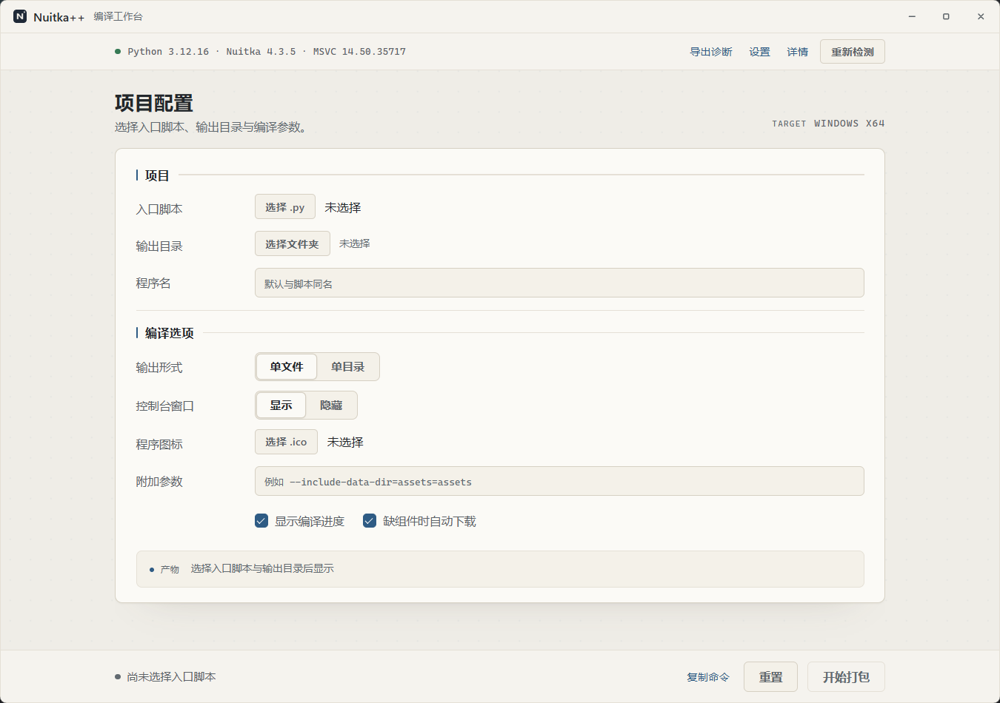
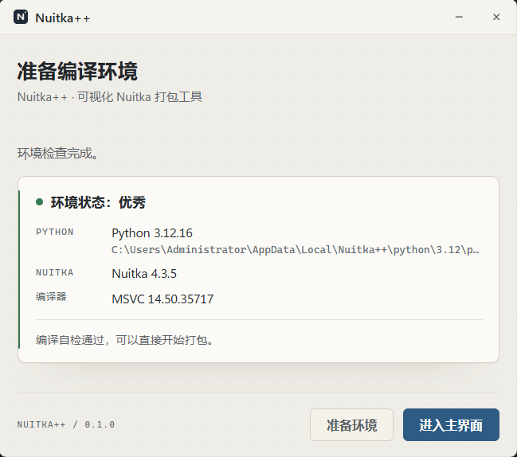
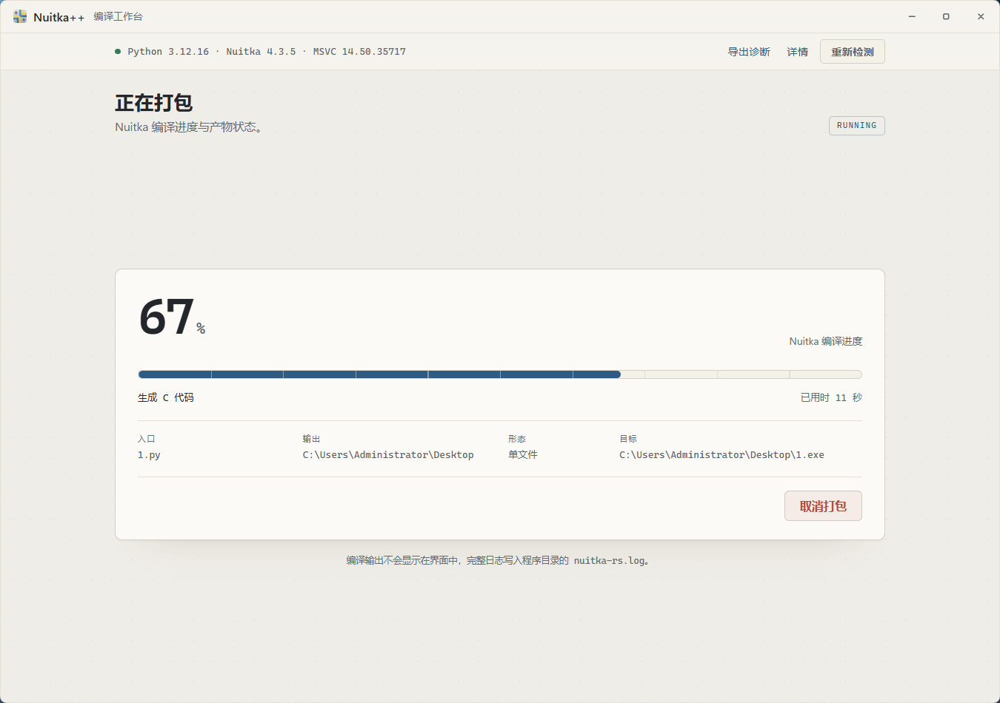
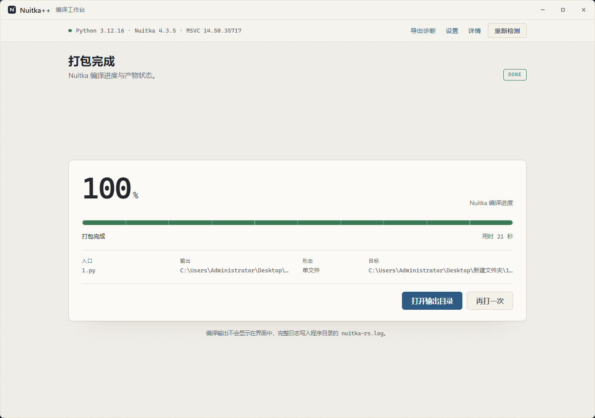

# Nuitka++

**查看中文文档**：
[中文](README.md)

<!-- Tech stack -->
[](https://www.rust-lang.org/)
[](https://tauri.app/)
[](https://nuitka.net/)

<!-- Target environment -->
[](https://www.microsoft.com/windows)
[](https://www.python.org/)
[](https://nuitka.net/)
[](https://developer.microsoft.com/microsoft-edge/webview2/)

<!-- Project info -->
[](LICENSE)
[](https://github.com/Nuln-Studio/Nuitka_/pulls)
***
**Build a Python EXE from scratch — even if you don't have Python installed, even if Nuitka isn't set up, even if no suitable C compiler is available. Nuitka++ handles it all in one click!**

`Once the app is downloaded, if your environment is incomplete, click "Prepare Environment" or "Prepare Now", then pick the Python version or C compiler you need (Python 3.13 and above: MSVC only. 3.12 and below: either works — MSVC is the pick on 3.12, winlibs on 3.11 and below), confirm, and the app will configure everything automatically.`
| Your environment is decent | Your environment is a mess |
| -- | -- |
|  |  |
***


The core is [Nuitka](https://nuitka.net/); the shell is Tauri 2 + Rust.

No need to memorize flags: pick a script, pick an output directory, hit Start (modular parameter blocks coming later).



## What it does

- **Environment self-check**: detects Python / Nuitka / MSVC / winlibs gcc and fills in whatever is missing (downloads portable Python, installs Nuitka from a mirror, triggers a winlibs download, or performs an unattended MSVC install)
- **Real compile verification**: after setup, it actually compiles and runs a hello program. Only a successful run counts as "Excellent"; a version check alone is at best "Pending verification"
- **One-click build**: single-file exe or standalone directory, with support for custom icon, console window toggle, and extra arguments
- **Progress, not log spam**: during the build you get a progress ring plus stage text; errors surface in a dialog with the reason, and full output goes to `nuitka-rs.log` next to the executable

On first launch it runs an environment check and only lets you in if you pass:



| Building | Done |
| --- | --- |
|  |  |

## Requirements

| Item | Requirement |
| --- | --- |
| OS | Windows 10 / 11 x64 |
| Python | 3.8+, 3.11+ recommended (installable by the app) |
| Compiler | MSVC or Nuitka's bundled winlibs — pick one (installable by the app) |
| Runtime | WebView2 Runtime (ships with Win10/Win11) |

## Build

```bash
cd nuitka-rs
cargo build          # or: cargo run
cargo test           # unit tests
```

The build output directory is set to `D:/cargo-target/nuitka-rs` in [`nuitka-rs/.cargo/config.toml`](nuitka-rs/.cargo/config.toml). Remember to change that line on a new machine, or set `CARGO_TARGET_DIR` in your IDE.

Besides unit tests, there are a few tests that actually compile an exe. They are skipped by default and require a fully set-up local environment (they're slow and will really invoke MSVC):

```bash
cargo test -- --ignored --nocapture
```

## Layout

```
nuitka-rs/
├── src/nuitka/       # core: component set + environment setup + build execution
├── src/ui/           # shell: Tauri commands and frontend
│   └── web/          # index.html / style.css / app.js
├── icons/            # app icons
└── capabilities/     # window permissions
```

See [项目结构.md](项目结构.md) for the full directory tree and design conventions.

## Documentation

| Doc | Contents |
| --- | --- |
| [项目结构.md](项目结构.md) | Directory tree, layering conventions, mind map |
| [Nuitka++项目规划（新修订）.md](Nuitka++项目规划（新修订）.md) | Product principles and phase planning |
| [python_discovery.md](nuitka-rs/src/nuitka/python_discovery/python_discovery.md) | Python discovery: registry / PATH / common dirs |
| [scannuitka.md](nuitka-rs/src/nuitka/scannuitka/scannuitka.md) | Nuitka discovery and version matrix |
| [scanmsvc.md](nuitka-rs/src/nuitka/scanmsvc/scanmsvc.md) | MSVC discovery and version requirements |
| [scangcc.md](nuitka-rs/src/nuitka/scangcc/scangcc.md) | gcc / winlibs discovery and PATH conflict detection |
| [docs/CONTRIBUTING.md](docs/CONTRIBUTING.md) | Contributing guide: branch names, commits, quality gates, code conventions |
| [CODE_OF_CONDUCT.md](CODE_OF_CONDUCT.md) | Code of conduct |

## Design trade-offs

- **Compiler must be specified explicitly**: on Windows, Nuitka defaults to MinGW and will ignore an already-verified MSVC, so every build passes `--msvc=<version>`. The version number comes from the scan result rather than `latest` (Nuitka can't recognize VS versions newer than it knows about).
- **Automatic fallback on failure**: if an MSVC build fails and Nuitka's cached winlibs is present locally, it automatically retries once with `--mingw64`.
- **Downloads are verified**: prefer checking the upstream sha256; if unavailable, validate the archive integrity. Extraction lands in a staging directory first, and only after `python.exe` is confirmed does it get renamed to the final directory.
- **One task at a time**: environment setup uses a directory lock, and the app itself is single-instance.

## Known limitations

- After MSVC finishes installing, the app (sometimes the whole system) has to be restarted before the new toolset gets picked up — there's no automatic re-check
- If your VS version is newer than Nuitka's known list, detection may fail; pin the version with the `NUITKA_RS_MSVC=14.50` environment variable
- No dark/light theme toggle yet — light only (maybe someday)

## Contributing

PRs are welcome. Code isn't the only thing that counts: a reproducible issue, a stretch of log, a screenshot, a fix to one clumsy sentence in the docs — all of it is contribution. The project is GPL-3.0, so submitting means you're fine with shipping under the same licence.

Before you start, these are worth reading:

| Doc | Read it when |
| --- | --- |
| [docs/CONTRIBUTING.md](docs/CONTRIBUTING.md) | Before your first PR. Branch names, commit conventions, quality gates, code conventions — all of it is in there |
| [CODE_OF_CONDUCT.md](CODE_OF_CONDUCT.md) | Argue hard about the code, never about the person. The specifics live here |
| [.github/pull_request_template.md](.github/pull_request_template.md) | Comes up automatically when you open a PR; just tick the boxes |
| [.github/ISSUE_TEMPLATE/bug_report.yml](.github/ISSUE_TEMPLATE/bug_report.yml) | Bug reports will ask for `nuitka-rs.log` plus your Python and compiler versions |

Run the quality gates at least once before you open that PR:

```bash
cd nuitka-rs
cargo build && cargo test --lib
```

Docs-only changes are fine too. This repo is Chinese-first with `.Eng.md` siblings (`README.Eng.md`, `docs/CONTRIBUTING.Eng.md`) — change one, change the other.