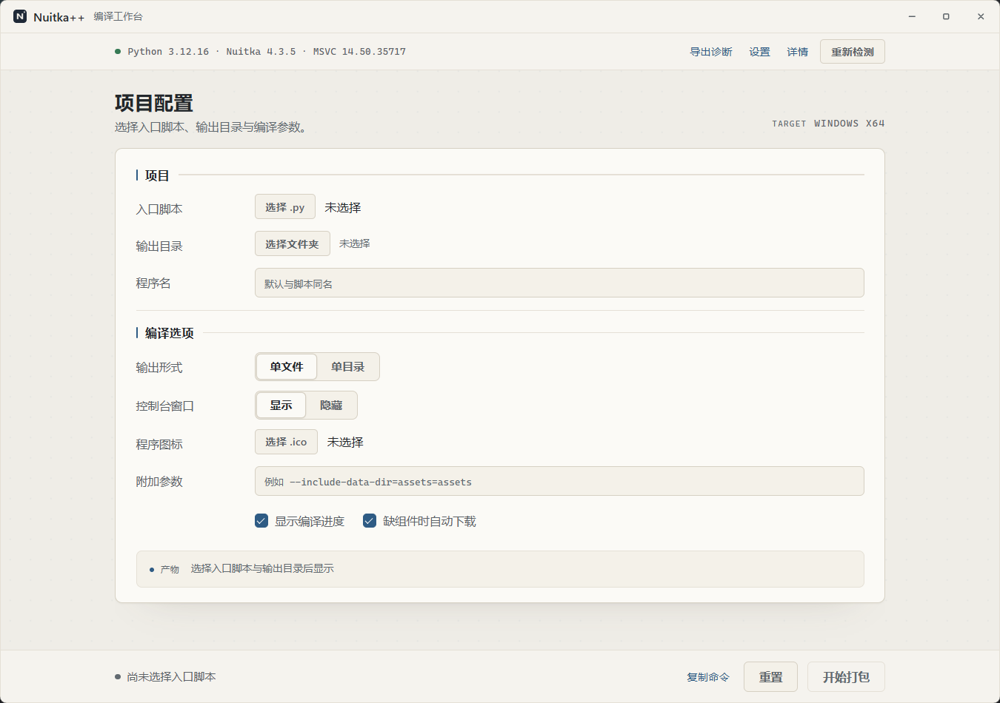
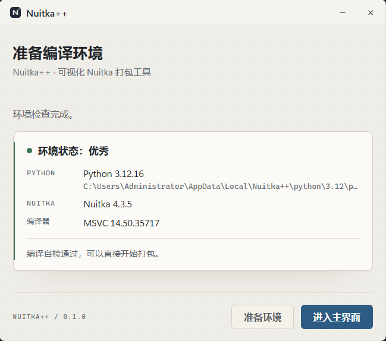
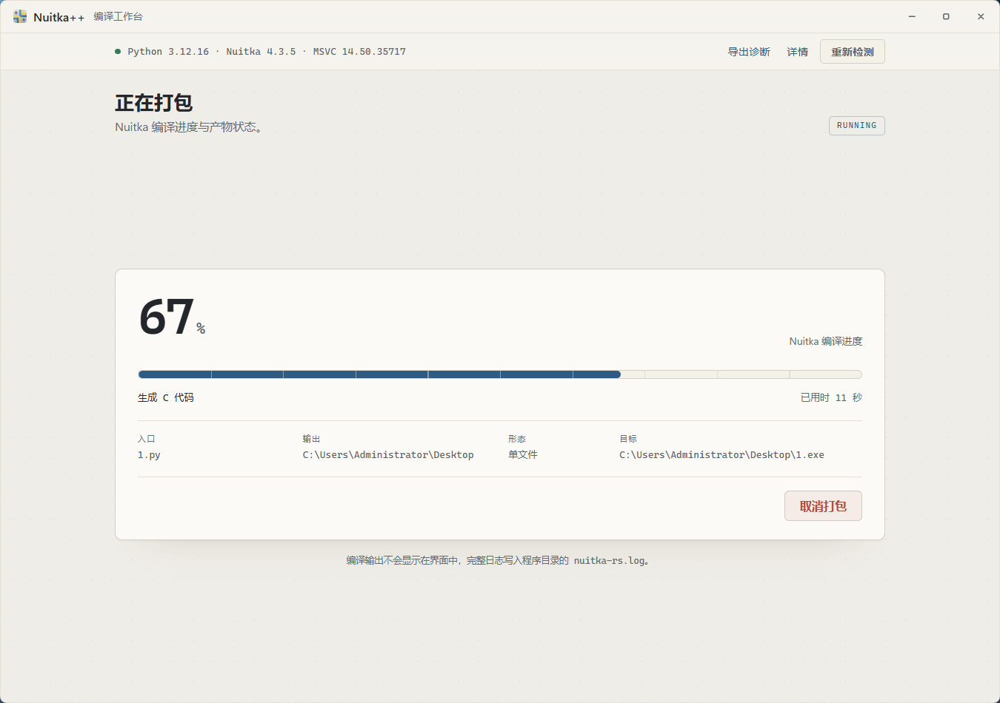
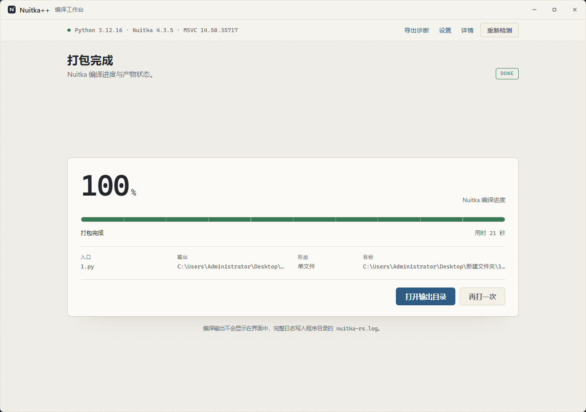

# Nuitka++

**Read in English**:
[English](README.Eng.md)


<!-- 技术栈 -->
[](https://www.rust-lang.org/)
[](https://tauri.app/)
[](https://nuitka.net/)

<!-- 目标环境 -->
[](https://www.microsoft.com/windows)
[](https://www.python.org/)
[](https://nuitka.net/)
[](https://developer.microsoft.com/microsoft-edge/webview2/)

<!-- 项目信息 -->
[](LICENSE)
[](https://github.com/Nuln-Studio/Nuitka_/pulls)
***
**从零构建PythonEXE程序，即使你没有Python，即使你没装nuitka，即使你没有适合的C编译器，都可以用Nuitka++来一键解决！**

`软件下载完成后，如果你的环境不完整，点击准备环境或立刻准备环境，随后按需选择Python版本或C编译器种类(3.12以上只能用MSVC)，确认即可开始自动帮您配置环境`
| 你的环境还不错 | 你的环境不咋地 |
| -- | -- |
|  |  |
***


内核是 [Nuitka](https://nuitka.net/)，外壳是 Tauri 2 + Rust

不用记参数：选脚本、选输出目录、点开始打包(后续做模块化参数块)



## 能做什么

- **环境自检**：找 Python / Nuitka / MSVC / winlibs gcc，缺什么补什么（下载便携 Python、镜像源装 Nuitka、触发 winlibs 下载或者无人值守安装MSVC）
- **真编译验证**：准备完会真编一个 hello 程序并运行它，跑通才算「优秀」，只看版本号最多算「待验证」
- **一键打包**：单文件 exe 或单目录，支持程序图标、控制台窗口开关、附加参数
- **只给进度，不刷日志**：打包时是进度环 + 阶段文字，出错弹窗给原因；完整输出在程序目录的 `nuitka-rs.log`

首次启动先做一轮环境检查，够格才放你进去：



| 打包中 | 完成 |
| --- | --- |
|  |  |

## 环境要求

| 项 | 要求 |
| --- | --- |
| 系统 | Windows 10 / 11 x64 |
| Python | 3.8 及以上，推荐 3.11 及以上(程序可装) |
| 编译器 | MSVC 或 Nuitka 自带的 winlibs，二选一(程序可装) |
| 运行时 | WebView2 Runtime(Win10/Win11 自带) |

## 构建

```bash
cd nuitka-rs
cargo build          # 或 cargo run
cargo test           # 单元测试
```

构建产物目录在 [`nuitka-rs/.cargo/config.toml`](nuitka-rs/.cargo/config.toml) 里指向 `D:/cargo-target/nuitka-rs`，换机器记得改这一行，或者在 IDE 里设 `CARGO_TARGET_DIR`。

单元测试之外还有几个会真编译一个 exe 的测试，默认跳过，需要本机环境齐全（比较慢，会真的调 MSVC）：

```bash
cargo test -- --ignored --nocapture
```

## 目录

```
nuitka-rs/
├── src/nuitka/       # 内核：组件集 + 准备环境 + 打包执行
├── src/ui/           # 外壳：Tauri 命令与前端
│   └── web/          # index.html / style.css / app.js
├── icons/            # 应用图标
└── capabilities/     # 窗口权限
```

完整目录树和设计约定见 [项目结构.md](项目结构.md)。

## 文档

| 文档 | 内容 |
| --- | --- |
| [项目结构.md](项目结构.md) | 目录树、分层约定、思维导图 |
| [Nuitka++项目规划（新修订）.md](Nuitka++项目规划（新修订）.md) | 产品原则与阶段规划 |
| [python_discovery.md](nuitka-rs/src/nuitka/python_discovery/python_discovery.md) | Python 探测：注册表 / PATH / 常见目录 |
| [scannuitka.md](nuitka-rs/src/nuitka/scannuitka/scannuitka.md) | Nuitka 探测与版本矩阵 |
| [scanmsvc.md](nuitka-rs/src/nuitka/scanmsvc/scanmsvc.md) | MSVC 探测与版本要求 |
| [scangcc.md](nuitka-rs/src/nuitka/scangcc/scangcc.md) | gcc / winlibs 探测与 PATH 冲突判定 |
| [docs/CONTRIBUTING.md](docs/CONTRIBUTING.md) | 贡献指南：分支命名、提交规范、质量门、代码约定 |
| [CODE_OF_CONDUCT.md](CODE_OF_CONDUCT.md) | 行为准则 |

## 一些实现上的取舍

- **编译器必须显式指定**：Nuitka 在 Windows 上默认走 MinGW，会无视已经验证过的 MSVC，所以打包时一律传 `--msvc=<版本>`；这个版本号是从扫描结果里取的，不是 `latest`（Nuitka 认不出比它新的 VS）。
- **失败自动降级**：MSVC 编译失败且本机有 Nuitka 缓存的 winlibs 时，自动换 `--mingw64` 重试一次。
- **下载要校验**：优先比对上游的 sha256，没有就验证压缩包完整性；解压先落到 staging，确认有 `python.exe` 才改名成正式目录。
- **同一时间只跑一个**：准备环境有目录锁，程序本身是单实例。

## 已知限制

- 单目录模式（`--standalone`）走的是同一条执行路径，但没做过端到端验证
- VS 版本比 Nuitka 已知列表还新时可能识别失败，可用环境变量 `NUITKA_RS_MSVC=14.50` 钉死版本
- 界面暂无深色/浅色切换，只有浅色（以后会做吧）

## 参与贡献

欢迎 PR。不是只有代码才算：一个能复现的 Issue、一段日志、一张界面截图、一句文档表述的纠正，都是贡献。仓库采用 GPL-3.0，提交即视为同意以同一协议发布。

动手之前，这几份建议先看一遍：

| 文档 | 什么时候看 |
| --- | --- |
| [docs/CONTRIBUTING.md](docs/CONTRIBUTING.md) | 第一次提 PR 前。分支命名、提交规范、质量门、代码约定全在里面 |
| [CODE_OF_CONDUCT.md](CODE_OF_CONDUCT.md) | 技术可以吵，人不能踩。这条线的具体写法在这里 |
| [.github/pull_request_template.md](.github/pull_request_template.md) | 提 PR 时自动带出来，Checklist 逐条打勾 |
| [.github/ISSUE_TEMPLATE/bug_report.yml](.github/ISSUE_TEMPLATE/bug_report.yml) | 报 Bug 时会问你要 `nuitka-rs.log`，以及 Python / 编译器版本 |

提 PR 前至少跑一遍质量门：

```bash
cd nuitka-rs
cargo build && cargo test --lib
```

只想改文档也行。这个仓库是中文为主、英文同名加 `.Eng.md`（`README.Eng.md`、`docs/CONTRIBUTING.Eng.md`），改一份记得同步另一份。
